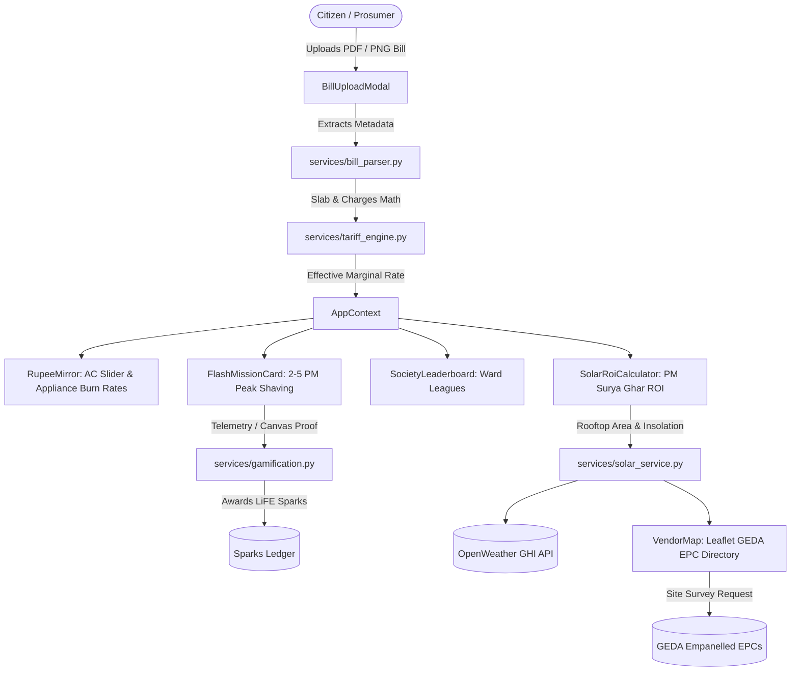

# ⚡ BijliLiFE: Mission LiFE Citizen Energy Engagement Platform

[](https://geda.gujarat.gov.in)
[](https://geda.gujarat.gov.in)
[](https://fastapi.tiangolo.com)
[](https://react.dev)

> **Production-grade citizen engagement prototype built for GEDA (Gujarat Energy Development Agency) & Mission LiFE (Lifestyle for Environment).**

BijliLiFE empowers Gujarat citizens to decode complex electricity tariffs, translate abstract kilowatt-hours into real-time **Rupee-per-hour burn rates**, shift heavy appliance loads away from grid strain hours, compete in cooperative society leagues, and adopt **PM Surya Ghar** rooftop solar with GEDA-empanelled EPC vendors.

---

## 🌟 Key Pillars & Core Innovations

### 1. 📑 Gujarat DISCOM OCR & Regex Bill Parser
- Deterministic extraction for Gujarat DISCOMs: **UGVCL**, **PGVCL**, **DGVCL**, **MGVCL**, and **Torrent Power**.
- Instantly extracts 11-digit Consumer Numbers, Sanctioned Load (kW), Billing Cycle Days, and Units Consumed (kWh).
- 1-click Quick-Load verified sample bills for instant hackathon evaluation without needing a scanner.

### 2. 🧮 GERC FY26 Telescopic Tariff Engine
- Implements official **GERC (Gujarat Electricity Regulatory Commission) FY26** residential telescopic slabs:
  - **Slab 1 (0 – 50 units):** ₹3.05 / kWh
  - **Slab 2 (51 – 100 units):** ₹3.50 / kWh
  - **Slab 3 (101 – 250 units):** ₹4.15 / kWh
  - **Slab 4 (251+ units):** ₹5.20 / kWh
- Additional statutory components:
  - **Fixed Charges:** ₹15 / kW / month
  - **Meter Rent:** ₹30 / billing cycle
  - **FPPPA (Fuel and Power Purchase Price Adjustment):** ₹2.50 / kWh
  - **Electricity Duty:** 15% on consumption charges
- Calculates both base marginal rate and **Effective Marginal Rate** ($\approx ₹8.48/\text{kWh}$ at the highest slab), exposing the true economic reward of curtailment.

### 3. 🪞 Real-Time Rupee-per-Hour Mirror & 24°C AC Simulator
- Real-time appliance matrix translating power ratings directly into ₹/hour cost based on marginal tariff.
- **Interactive AC Temperature Slider (16°C – 28°C):**
  - Uses the thermodynamic rule of thumb: Every $1^\circ\text{C}$ rise above $18^\circ\text{C}$ saves $\approx 6.5\%$ power.
  - At $24^\circ\text{C}$ (Mission LiFE optimal standard): Power draw drops from $1.8\,\text{kW}$ to $1.1\,\text{kW}$ ($\approx 39\%$ reduction, saving ₹1,500+/month).
  - Calculates carbon footprint using **Central Electricity Authority (CEA)** grid emission benchmark ($0.716\,\text{kg CO}_2/\text{kWh}$) and equivalent mature tree offsets.

### 4. 🏆 Flash Quests & Society Derby Gamification
- Dynamic peak shaving quests targeting Gujarat's afternoon thermal peak (**2:00 PM – 5:00 PM**).
- Optical / Canvas validation checking AC remote screen settings ($\ge 24^\circ\text{C}$) and awarding **LiFE Sparks** with celebratory confetti.
- **Inter-Society Derby:** Ward vs Ward leagues (**Bodakdev vs Navrangpura vs Pal vs Alkapuri**) showing total power shifted, carbon avoided, and community tree equivalents.
- Cooperative cheering feature boosting neighbor engagement.

### 5. ☀️ PM Surya Ghar Rooftop ROI & GEDA Vendor GIS Map
- Sizing model calibrated to Gujarat's high solar insolation ($1\,\text{kW} = 120\,\text{kWh}/\text{month} = 1,440\,\text{kWh}/\text{year}$).
- **PM Surya Ghar: Muft Bijli Yojana Central Financial Assistance (CFA) 2026 Subsidy:**
  - $1\,\text{kW}$: ₹30,000
  - $2\,\text{kW}$: ₹60,000
  - $3\,\text{kW}+$ : ₹78,000 (Capped)
- Calculates simple payback (typically $3.0 - 4.2$ years in Gujarat) factoring GUVNL ₹2.25/unit surplus export net metering.
- Interactive Leaflet GIS map displaying **6 GEDA-empanelled EPC solar vendors** across Ahmedabad, Surat, Vadodara, Rajkot, and Gandhinagar with 1-click free site survey requests.

---

## 🏗️ System Architecture Flow



---

## 📂 Repository Directory Layout

```
bijlilife/
├── README.md                      # Comprehensive project documentation
├── docker-compose.yml             # Orchestration for Frontend, Backend, & Postgres
├── backend/
│   ├── requirements.txt           # Python backend dependencies
│   ├── Dockerfile                 # Backend containerization
│   ├── .env.example               # Backend environment variables
│   ├── main.py                    # FastAPI entrypoint & router aggregation
│   ├── core/
│   │   ├── config.py              # Pydantic v2 application settings
│   │   └── database.py            # SQLAlchemy 2.0 async engine & sessionmaker
│   ├── models/
│   │   ├── user.py                # User & resident schema
│   │   ├── bill.py                # Electricity bill schema
│   │   └── gamification.py        # Society, Challenge, Sparks, Vendor models
│   ├── schemas/
│   │   ├── bill.py                # Pydantic request/response schemas for bills
│   │   ├── solar.py               # Solar sizing & ROI schemas
│   │   └── challenge.py           # Gamification & verification schemas
│   ├── services/
│   │   ├── tariff_engine.py       # GERC FY26 Telescopic slab & FPPPA engine
│   │   ├── bill_parser.py         # Regex/OCR extraction for Gujarat DISCOMs
│   │   ├── life_calculator.py     # CEA CO2 math & appliance ₹/hr mirror
│   │   ├── solar_service.py       # PM Surya Ghar CFA subsidy & yield model
│   │   └── gamification.py        # Society leaderboard & photo verification
│   ├── routers/
│   │   ├── bills.py               # Bill upload, sample loading, tariff endpoints
│   │   ├── challenges.py          # Flash quests & proof verification
│   │   ├── solar.py               # Rooftop ROI, weather insolation, quotes
│   │   └── leaderboard.py         # Inter-society leagues & cheer endpoints
│   └── alembic/
│       ├── alembic.ini            # Alembic database migration config
│       ├── env.py                 # Async migration runner
│       └── versions/
│           └── 0001_initial_schema.py # Initial database migration
└── frontend/
    ├── package.json               # Frontend dependencies (React, Leaflet, Recharts)
    ├── Dockerfile                 # Frontend multi-stage Nginx containerization
    ├── nginx.conf                 # Production Nginx reverse proxy configuration
    ├── vite.config.js             # Vite configuration with /api proxy
    ├── tailwind.config.js         # Custom dark theme & styling colors
    ├── postcss.config.js          # PostCSS configuration
    ├── index.html                 # HTML shell with Google Fonts & Leaflet styles
    └── src/
        ├── main.jsx               # React DOM root
        ├── App.jsx                # Core application dashboard & tab router
        ├── index.css              # Custom scrollbars, glow effects, leaflet styles
        ├── context/
        │   └── AppContext.jsx     # Global state for active bill, user, sparks
        ├── utils/
        │   └── api.js             # Resilient API client with client fallback
        └── components/
            ├── Navbar.jsx             # Mission LiFE & GEDA header, sparks counter
            ├── BillUploadModal.jsx    # Drag-and-drop parser with sample bills
            ├── RupeeMirror.jsx        # Wattage-to-₹/hr mirror & 24°C AC slider
            ├── FlashMissionCard.jsx   # Peak-hour quests with photo proof
            ├── SocietyLeaderboard.jsx # Ward derby & flat leaderboard
            ├── SolarRoiCalculator.jsx # 25-yr financial graph & subsidy slider
            └── VendorMap.jsx          # Leaflet GIS map with 6 GEDA solar EPCs
```

---

## 🚀 Quickstart & Setup Guide

### Method 1: Local Development (Instant Zero-Setup)

#### Backend Setup:
```bash
# 1. Navigate to backend
cd backend

# 2. Create and activate a virtual environment
python -m venv venv
# On Windows:
.\venv\Scripts\activate
# On Linux/macOS:
source venv/bin/activate

# 3. Install dependencies
pip install -r requirements.txt

# 4. Start the FastAPI development server
uvicorn main:app --reload --host 0.0.0.0 --port 8000
```
> The API will be live at `http://127.0.0.1:8000`. Interactive OpenAPI documentation is accessible at `http://127.0.0.1:8000/docs`.

#### Frontend Setup:
```bash
# 1. Open a new terminal and navigate to frontend
cd frontend

# 2. Install dependencies
npm install

# 3. Start the Vite development server
npm run dev
```
> The frontend will be live at `http://localhost:5173`.

---

### Method 2: Docker Compose (Production Environment)

To run the complete production stack (PostgreSQL 15, FastAPI Async Backend, and React Nginx Frontend):
```bash
docker-compose up --build
```
- Frontend: `http://localhost:3000`
- Backend API: `http://localhost:8000`
- Postgres Database: `localhost:5432`

---

## 🧪 Live Demo Walkthrough Guide

Follow these steps for a complete evaluation of the prototype:

1. **Dashboard Overview:**
   - Observe the live GEDA Track 1 header, active resident profile (*Aarav Patel, Gokuldham Residency, Flat B-402*), and live **420 LiFE Sparks** counter.
   - Note the active DISCOM selector (*UGVCL, PGVCL, DGVCL, MGVCL, Torrent Power*).

2. **Upload & Parse a DISCOM Bill:**
   - Click **"Upload Bill"** or **"Switch / Upload Bill"**.
   - Under *Quick-Load Verified Gujarat Sample Bills*, click **"Sample UGVCL Residential Bill (320 Units)"**.
   - Watch the animated telemetry extractor match the 11-digit Consumer ID, Sanctioned Load (4 kW), and apply GERC FY26 slabs, FPPPA (₹2.50/unit), and 15% duty.
   - Click **"Apply to Dashboard"** to see all figures instantly update globally.

3. **Explore the Rupee Mirror & AC Simulator:**
   - Switch to the **"Rupee Mirror"** tab.
   - Review the appliance burn rates ($1.5\,\text{T AC chilled}$ @ ₹15.26/hr vs $24^\circ\text{C}$ @ ₹9.33/hr).
   - Drag the **AC Temperature Slider** from $18^\circ\text{C}$ to $24^\circ\text{C}$:
     - Watch active power draw drop from $1.8\,\text{kW}$ to $1.1\,\text{kW}$.
     - Observe monthly savings of **₹1,470+** and avoided $\text{CO}_2$ emissions.
   - Click **"Lock 24°C & Claim +80 Sparks"** to trigger celebratory confetti!

4. **Complete a Flash Mission:**
   - Switch to the **"Flash Quests"** tab.
   - Locate the **"Gujarat Afternoon Peak Shaving"** or **"Mission LiFE 24°C AC Lock"** quest.
   - Click **"Verify with Photo"**.
   - Click **"Open Camera / Capture Telemetry"** to generate the simulated HUD proof.
   - Click **"Confirm & Earn Sparks"** to update your ledger balance and push your society further up the league!

5. **Cheer Your Society in the Derby:**
   - Switch to the **"Society Derby"** tab.
   - View the inter-society league (*Bodakdev vs Navrangpura vs Pal vs Alkapuri*).
   - Click **"Cheer (+10)"** to boost your society with live sparks.
   - Toggle to **"Gokuldham Residency (Flat Leaderboard)"** to view your flat's internal ranking (#3).

6. **Calculate Rooftop Solar ROI & Find GEDA EPC Vendors:**
   - Switch to the **"PM Surya Ghar"** tab.
   - Adjust the **Rooftop Area Slider** (e.g. 400 sq.ft for a 3 kW setup).
   - Observe the **₹78,000 PM Surya Ghar CFA Subsidy**, net investment, and 25-year cumulative savings graph.
   - Check the live solar insolation telemetry ($785.4\,\text{W/m}^2$ GHI in Ahmedabad).
   - Click **"Find GEDA-Empanelled EPC Vendors"** to open the interactive **Leaflet GIS Map**.
   - Select an EPC installer (e.g. *Adani Solar*, *Waaree*, or *Tata Power Solar*) and click **"Request Free Site Quote"** to earn **+200 Sparks**!

---

## 📜 Compliance & Benchmark References
- **GERC Tariff Order FY26:** Sbar-scaled telescopic residential tariff rates.
- **BEE (Bureau of Energy Efficiency) India:** Standard $24^\circ\text{C}$ default setpoint recommendation.
- **CEA (Central Electricity Authority) CO2 Baseline Database:** Grid average $0.716\,\text{kg CO}_2/\text{kWh}$.
- **PM Surya Ghar: Muft Bijli Yojana (2026 Guidelines):** Central Financial Assistance (CFA) schedule for residential rooftop systems.
- **GEDA (Gujarat Energy Development Agency):** Empanelled EPC guidelines and GUVNL net metering surplus buyback rate (₹2.25/unit).

---

© 2026 BijliLiFE Platform. Developed for Mission LiFE Citizen Engagement Challenge (Track 1: Green Energy & Sustainability - GEDA / HC26-GEDA01).
